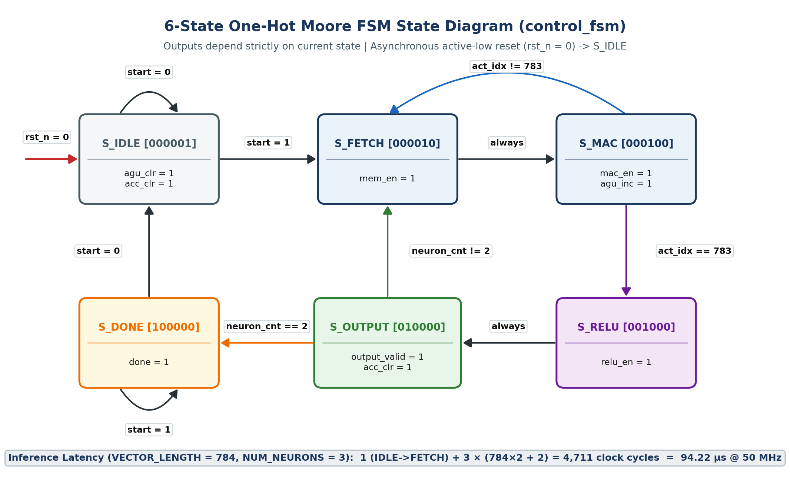
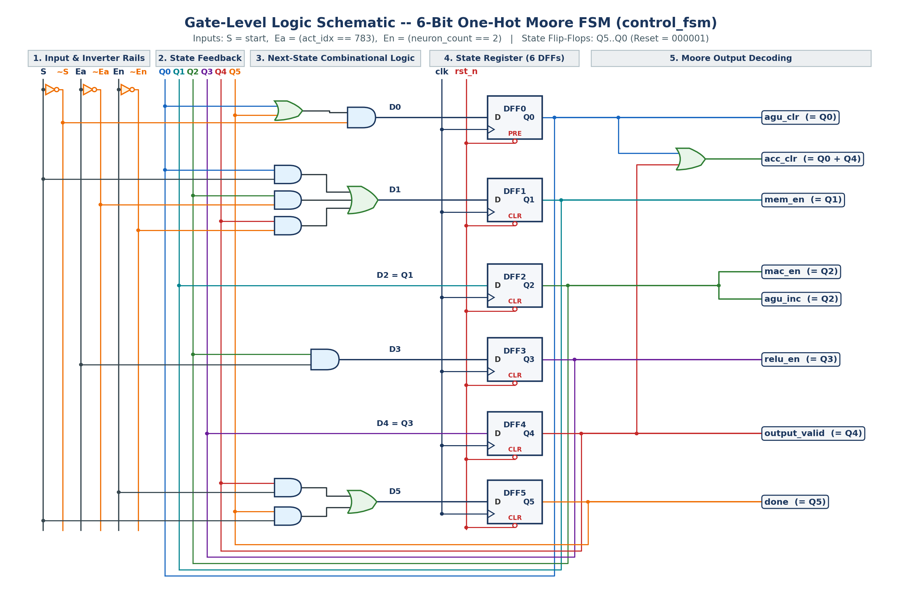
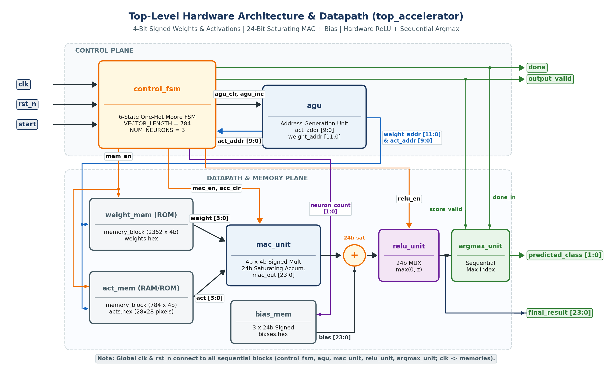
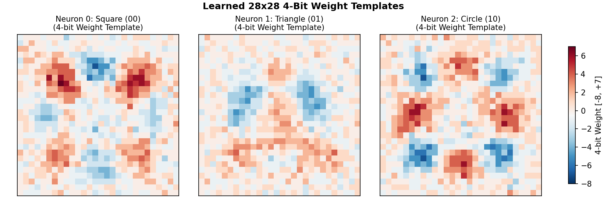

# 4-Bit Quantized Shape Classification Hardware Accelerator

A synthesizable **Verilog-2001 Hardware Neural Network Accelerator** for edge classification of **28×28 grayscale images (784 pixels, 4-bit signed per pixel)** into three geometric shape classes without requiring an external CPU or operating system:

| `predicted_class [1:0]` | Shape Class | Description |
| :---: | :--- | :--- |
| `2'b00` (`0`) | **Square** | 28×28 filled square (including noisy/corrupted variants) |
| `2'b01` (`1`) | **Triangle** | 28×28 upward-pointing filled isosceles triangle |
| `2'b10` (`2`) | **Circle** | 28×28 filled circle (including shifted/noisy variants) |

At a **50 MHz** clock (`20 ns` period), a complete 3-neuron inference finishes in **4,711 clock cycles (`94,220 ns` = `94.22 µs`)**, with `predicted_class` valid at the exact rising edge of `done` (zero-cycle output lag).

---

## Table of Contents
1. [System I/O & Data Widths](#1-system-io--data-widths)
2. [FSM Architecture & State Encoding](#2-fsm-architecture--state-encoding)
3. [FSM State Diagram & Cycle Latency](#3-fsm-state-diagram--cycle-latency)
4. [Next-State & Output Truth Tables](#4-next-state--output-truth-tables)
5. [Boolean Equations](#5-boolean-equations)
6. [Gate-Level Schematic & Top-Level Block Diagram](#6-gate-level-schematic--top-level-block-diagram)
7. [Training, 4-Bit Quantization & Simulation Verification](#7-training-4-bit-quantization--simulation-verification)
8. [Repository Structure & How to Run](#8-repository-structure--how-to-run)

---

## 1. System I/O & Data Widths

### 1.1 Top-Level Parameters (`top_accelerator`)

| Parameter / Localparam | Value | Meaning |
| :--- | :---: | :--- |
| `DATA_WIDTH` | `4` | Signed 4-bit two's complement weights & pixel activations (`[-8, +7]`) |
| `ACC_WIDTH` | `24` | Signed 24-bit accumulator, bias, and ReLU data width (`[-8,388,608, +8,388,607]`) |
| `VECTOR_LENGTH` | `784` | Input feature vector size (`28 × 28` pixels) |
| `NUM_NEURONS` | `3` | Number of output classes (`Square`, `Triangle`, `Circle`) |
| `ACT_ADDR_WIDTH` | `10` | $\lceil \log_2(784) \rceil$ — addresses `0..783` in `act_mem` |
| `WEIGHT_ADDR_WIDTH` | `12` | $\lceil \log_2(784 \times 3) \rceil$ — addresses `0..2351` in `weight_mem` |
| `NEURON_ADDR_WIDTH` | `2` | $\lceil \log_2(3) \rceil$ — addresses `0..2` in `bias_mem` and `argmax_unit` |

### 1.2 Top-Level External Ports (`top_accelerator`)

| Signal | Direction | Width | Signed | Active Level / Timing | Description |
| :--- | :---: | :---: | :---: | :--- | :--- |
| `clk` | `input` | `1` bit | — | Rising edge (`50 MHz`) | System clock driving all synchronous registers |
| `rst_n` | `input` | `1` bit | — | Active-low, async | Asynchronous reset; initializes FSM to `S_IDLE`, clears accumulators & addresses |
| `start` | `input` | `1` bit | — | Active-high (`1`) | Starts inference when in `S_IDLE`; must return to `0` in `S_DONE` for next run |
| `done` | `output` | `1` bit | — | Active-high (`1`) | Asserted in `S_DONE` when all 3 neurons finish |
| `output_valid` | `output` | `1` bit | — | Active-high (`1`) | Pulses for 1 clock cycle per neuron in `S_OUTPUT` (`final_result` is valid) |
| `final_result` | `output` | `24` bits (`[23:0]`) | Signed | Valid on `output_valid` | ReLU-activated neuron score: $\max(0, \mathbf{w}_n \cdot \mathbf{x} + b_n)$ |
| `predicted_class` | `output` | `2` bits (`[1:0]`) | Unsigned | Valid on `done` | Winning class index (`2'b00`=Square, `2'b01`=Triangle, `2'b10`=Circle) |

### 1.3 Control Unit Signals (`control_fsm`)

| Signal | Direction | Width | Description |
| :--- | :---: | :---: | :--- |
| `clk`, `rst_n`, `start` | `input` | `1` bit each | Clock, async active-low reset, inference start control |
| `current_act_index` | `input` | `10` bits (`[9:0]`) | `act_addr[9:0]` from `agu`; triggers end-of-vector at `783` |
| `mem_en` | `output` | `1` bit | Synchronous read enable for `weight_mem` and `act_mem` |
| `mac_en` | `output` | `1` bit | Accumulate enable for `mac_unit` |
| `acc_clr` | `output` | `1` bit | Synchronous accumulator clear (held high in `S_IDLE` and `S_OUTPUT`) |
| `agu_inc` | `output` | `1` bit | Increments `weight_addr` and `act_addr` in `agu` |
| `agu_clr` | `output` | `1` bit | Synchronous address reset for `agu` (held high in `S_IDLE`) |
| `relu_en` | `output` | `1` bit | Latches `max(0, mac_out + bias)` in `relu_unit` |
| `output_valid` | `output` | `1` bit | Signals `argmax_unit` and external observers that `final_result` is valid |
| `done` | `output` | `1` bit | Asserted when all `NUM_NEURONS` scores are complete |
| `neuron_count` | `output` | `2` bits (`[1:0]`) | Internal neuron counter (`0, 1, 2`) indexing `bias_mem` |

### 1.4 Internal Datapath Buses & Memories

| Internal Bus / Block | Width / Depth | Representation | Function |
| :--- | :---: | :--- | :--- |
| `weight_mem` (`memory_block`) | `2352 × 4` bits | 4-bit signed (`[-8, +7]`) | Stores 3 flattened 28×28 neuron weight templates (`weights.hex`) |
| `act_mem` (`memory_block`) | `784 × 4` bits | 4-bit signed (`[-8, +7]`) | Stores quantized 28×28 input image (`acts.hex`) |
| `bias_mem` (`reg` array) | `3 × 24` bits | 24-bit signed two's complement | Combinational bias ROM (`biases.hex`), indexed by `neuron_count[1:0]` |
| `product` (inside `mac_unit`) | `8` bits (`[7:0]`) | Signed `4b × 4b` (`[-56, +64]`) | Combinational two's complement product (`signed_w * signed_a`) |
| `mac_out` | `24` bits (`[23:0]`) | 24-bit signed saturated | Registered dot-product accumulator ($\sum w \cdot x$) |
| `mac_plus_bias` | `24` bits (`[23:0]`) | 24-bit signed | Combinational bias sum: `$signed(mac_out) + current_bias` |

---

## 2. FSM Architecture & State Encoding

### Moore Architecture Rationale
The controller (`control_fsm.v`) is designed as a **Moore Finite State Machine**:
- Every control output (`mem_en`, `mac_en`, `acc_clr`, `agu_inc`, `agu_clr`, `relu_en`, `output_valid`, `done`) depends **strictly on the state** (registered cleanly from `next_state` on `posedge clk`), guaranteeing **glitch-free control signals** to memories, MAC, ReLU, and Argmax units.
- **6-bit One-Hot encoding** (`Q[5:0]`) is used because each state maps directly to a single flip-flop (`Q0`–`Q5`), eliminating multi-bit binary state decoders on the critical path—which is ideal for FPGA/ASIC register-rich implementations.

### State Encoding Table

| State Name | One-Hot Binary (`Q5 Q4 Q3 Q2 Q1 Q0`) | Flip-Flop | Purpose | Active Outputs (`= 1`) |
| :--- | :---: | :---: | :--- | :--- |
| `S_IDLE` | `6'b000001` | `Q0` | Reset/idle state; holds AGU and MAC cleared until `start=1` | `agu_clr`, `acc_clr` |
| `S_FETCH` | `6'b000010` | `Q1` | Enables synchronous read of `weight_mem` & `act_mem` (1-cycle latency) | `mem_en` |
| `S_MAC` | `6'b000100` | `Q2` | Accumulates `weight × activation` and increments `agu` addresses | `mac_en`, `agu_inc` |
| `S_RELU` | `6'b001000` | `Q3` | Applies ReLU to `mac_out + current_bias` and registers `final_result` | `relu_en` |
| `S_OUTPUT` | `6'b010000` | `Q4` | Publishes `output_valid` to `argmax_unit`, clears MAC for next neuron | `output_valid`, `acc_clr` |
| `S_DONE` | `6'b100000` | `Q5` | Signals inference completion (`done=1`); holds `predicted_class` until `start=0` | `done` |

### Shorthand Transition Condition Variables
To keep the truth tables and Boolean equations compact:

$$S = \text{start}, \qquad E_a = (\text{current\_act\_index} == 783), \qquad E_n = (\text{internal\_neuron\_count} == 2)$$

---

## 3. FSM State Diagram & Cycle Latency



### Cycle-by-Cycle Execution & Exact Latency
1. **`S_IDLE` → `S_FETCH`** (`1` cycle when `start = 1`).
2. **Per-Neuron Loop** (repeated `NUM_NEURONS = 3` times):
   - **`S_FETCH ↔ S_MAC`** executes `VECTOR_LENGTH = 784` iterations (`2 × 784 = 1,568` cycles).
   - **`S_RELU`** (`1` cycle) latches `ReLU(mac_out + bias)`.
   - **`S_OUTPUT`** (`1` cycle) asserts `output_valid = 1` for `argmax_unit`, clears `mac_out`, and increments `internal_neuron_count`.
   - Total per neuron = `1,568 + 2 = 1,570` cycles.
3. **Total Inference Latency**:

$$N_{\text{cycles}} = 1 + 3 \times (2 \times 784 + 2) = 1 + 3 \times 1570 = 4,711\text{ clock cycles}$$

$$T_{\text{inference}} = 4,711 \times 20\text{ ns} = 94,220\text{ ns} = 94.22\text{ }\mu\text{s}\quad (@\ 50\text{ MHz})$$

---

## 4. Next-State & Output Truth Tables

### Signal Priority Hierarchy
1. **Highest Priority — Asynchronous Reset (`rst_n = 0`):** Immediately forces `Q[5:0] <= 6'b000001` (`S_IDLE`), `internal_neuron_count <= 0`, and all control outputs to their reset values (`acc_clr = 1`, `agu_clr = 1`, all others `0`), regardless of `clk`, `start`, $E_a$, or $E_n$.
2. **Current Active State (`Q5..Q0`):** Exactly one flip-flop is `1` at any cycle in valid One-Hot operation.
3. **State-Relevant Condition (`S`, `Ea`, `En`):** Irrelevant conditions in a given state are marked as Don't Care (`X`).

### 4.1 Next-State Truth Table

| `rst_n` | Current State | `Q5..Q0` | `S` (`start`) | `Ea` (`act==783`) | `En` (`neuron==2`) | Next State | `D5..D0` |
| :---: | :--- | :---: | :---: | :---: | :---: | :--- | :---: |
| `0` | Any (`X`) | `XXXXXX` | `X` | `X` | `X` | `S_IDLE` (async preset/clear) | `000001` |
| `1` | `S_IDLE` | `000001` | `0` | `X` | `X` | `S_IDLE` | `000001` |
| `1` | `S_IDLE` | `000001` | `1` | `X` | `X` | `S_FETCH` | `000010` |
| `1` | `S_FETCH` | `000010` | `X` | `X` | `X` | `S_MAC` | `000100` |
| `1` | `S_MAC` | `000100` | `X` | `0` | `X` | `S_FETCH` | `000010` |
| `1` | `S_MAC` | `000100` | `X` | `1` | `X` | `S_RELU` | `001000` |
| `1` | `S_RELU` | `001000` | `X` | `X` | `X` | `S_OUTPUT` | `010000` |
| `1` | `S_OUTPUT` | `010000` | `X` | `X` | `0` | `S_FETCH` | `000010` |
| `1` | `S_OUTPUT` | `010000` | `X` | `X` | `1` | `S_DONE` | `100000` |
| `1` | `S_DONE` | `100000` | `0` | `X` | `X` | `S_IDLE` | `000001` |
| `1` | `S_DONE` | `100000` | `1` | `X` | `X` | `S_DONE` | `100000` |

### 4.2 Moore Output Truth Table

| Current State | `Q5..Q0` | `agu_clr` | `acc_clr` | `mem_en` | `mac_en` | `agu_inc` | `relu_en` | `output_valid` | `done` |
| :--- | :---: | :---: | :---: | :---: | :---: | :---: | :---: | :---: | :---: |
| `S_IDLE` | `000001` | `1` | `1` | `0` | `0` | `0` | `0` | `0` | `0` |
| `S_FETCH` | `000010` | `0` | `0` | `1` | `0` | `0` | `0` | `0` | `0` |
| `S_MAC` | `000100` | `0` | `0` | `0` | `1` | `1` | `0` | `0` | `0` |
| `S_RELU` | `001000` | `0` | `0` | `0` | `0` | `0` | `1` | `0` | `0` |
| `S_OUTPUT` | `010000` | `0` | `1` | `0` | `0` | `0` | `0` | `1` | `0` |
| `S_DONE` | `100000` | `0` | `0` | `0` | `0` | `0` | `0` | `0` | `1` |

---

## 5. Boolean Equations

### 5.1 FSM Next-State Equations ($D_0$–$D_5$)

From the One-Hot Next-State Truth Table (`rst_n = 1`):

$$D_0 = (Q_0 + Q_5) \cdot \overline{S}$$

$$D_1 = (Q_0 \cdot S) + (Q_2 \cdot \overline{E_a}) + (Q_4 \cdot \overline{E_n})$$

$$D_2 = Q_1$$

$$D_3 = Q_2 \cdot E_a$$

$$D_4 = Q_3$$

$$D_5 = (Q_4 \cdot E_n) + (Q_5 \cdot S)$$

*(With `rst_n = 0`, `DFF0` asynchronously presets `Q0 <= 1` and `DFF1..DFF5` asynchronously clear `Q1..Q5 <= 0`.)*

### 5.2 FSM Moore Output Equations

Because the encoding is One-Hot, almost every output is a direct wire tap from its state flip-flop—only `acc_clr` requires a single 2-input OR gate:

$$\text{agu\_clr} = Q_0 \qquad \text{acc\_clr} = Q_0 + Q_4 \qquad \text{mem\_en} = Q_1$$

$$\text{mac\_en} = Q_2 \qquad \text{agu\_inc} = Q_2 \qquad \text{relu\_en} = Q_3$$

$$\text{output\_valid} = Q_4 \qquad \text{done} = Q_5$$

### 5.3 Datapath Arithmetic Equations

- **4-Bit Signed Multiplication & Sign-Extension (`mac_unit.v`):**

$$p[7:0] = \text{signed}(w[3:0]) \times \text{signed}(a[3:0]), \qquad p_{\text{ext}}[23:0] = \{\{16\{p[7]\}\},\ p[7:0]\}$$

- **24-Bit Saturating Accumulation (`sum = mac_out + p_ext`):**

$$\text{pos\_ovf} = \overline{\text{mac\_out}[23]} \cdot \overline{p_{\text{ext}}[23]} \cdot \text{sum}[23], \qquad \text{neg\_ovf} = \text{mac\_out}[23] \cdot p_{\text{ext}}[23] \cdot \overline{\text{sum}[23]}$$

$$\text{mac\_out}^{+} = \begin{cases} +8,388,607\ (\texttt{24'h7FFFFF}), & \text{if } \text{pos\_ovf} = 1 \\ -8,388,608\ (\texttt{24'h800000}), & \text{if } \text{neg\_ovf} = 1 \\ \text{sum}[23:0], & \text{otherwise} \end{cases}$$

- **Bias Addition & ReLU (`top_accelerator.v`, `relu_unit.v`):**

$$z_n = \text{mac\_out}_n + b_n, \qquad \text{final\_result}_n = \text{ReLU}(z_n) = \overline{z_n[23]} \cdot z_n = \max(0,\ z_n)$$

- **Sequential Argmax (`argmax_unit.v`):** On each `score_valid = 1` pulse ($n \in \{0, 1, 2\}$), updates `predicted_class` immediately whenever `n == 0` or `score > max_score`, so `predicted_class` is already settled on the exact rising edge of `done`.

---

## 6. Gate-Level Schematic & Top-Level Block Diagram

### 6.1 FSM Gate-Level Logic Circuit (`control_fsm`)
The gate-level implementation below maps the Boolean equations ($D_0$–$D_5$ and Moore outputs) directly onto standard NOT, 2-input/3-input AND/OR gates, and 6 edge-triggered D flip-flops:



### 6.2 Top-Level Architecture & Datapath (`top_accelerator`)
The accelerator separates the **Control Plane** (`control_fsm` + `agu`) from the **Datapath & Memory Plane** (`weight_mem`, `act_mem`, `mac_unit`, `bias_mem`, `relu_unit`, `argmax_unit`):



---

## 7. Training, 4-Bit Quantization & Simulation Verification

### 7.1 8×8 Anti-Aliased Dataset & 4-Bit Quantization (`train_shape_model.py`)
- Synthetic 28×28 datasets (`1,800` training / `450` validation samples) are rasterized on a **224×224 sub-pixel grid (8×8 supersampling)** and averaged back to 28×28 pixels, producing smooth anti-aliased edges that genuinely utilize intermediate 4-bit grayscale levels (`[0, 1, 2, 4, 5, 6, 7]`).
- A linear classifier (`W: 3×784`, `b: 3`) is trained with Softmax + Cross-Entropy + L2 regularization on quantized inputs, then quantized to signed 4-bit weights (`[-8, +7]`) and 24-bit biases:
  - **Quantized (`ReLU + Argmax`) Training Accuracy:** `100.00%`
  - **Quantized (`ReLU + Argmax`) Validation Accuracy:** `99.56%`




### 7.2 Bit-Exact Hardware Verification (Questa 2025.2)

- **Unit Verification (`tb_full_brute_force.v`):** `270 / 270` checks passed (`0` errors, `0` warnings) — exhaustive `256/256` signed 4-bit multiplications, `4/4` positive/negative/mixed saturation scenarios, and `10/10` ReLU boundary tests.
- **System Verification (`tb_brute_force.v`):** `6 / 6` shape classification tests passed (`0` errors, `0` warnings) at `@(posedge done)` with `94,220 ns` latency per inference and **100% bit-exact score parity** against the Python Golden Model:

| Test | Scenario | Expected | Python ReLU Scores `[Sq, Tri, Cir]` | Questa RTL `ARGMAX` Scores | Hardware Result | Latency |
| :---: | :--- | :---: | :---: | :---: | :---: | :---: |
| 1 | Clean Square (`test_1.hex`) | `00` (Square) | `[1068, 0, 0]` | `[1068, 0, 0]` | `00 (SQUARE)` **[PASS]** | `94,220 ns` |
| 2 | Clean Triangle (`test_2.hex`) | `01` (Triangle) | `[0, 938, 0]` | `[0, 938, 0]` | `01 (TRIANGLE)` **[PASS]** | `94,220 ns` |
| 3 | Clean Circle (`test_3.hex`) | `10` (Circle) | `[0, 0, 899]` | `[0, 0, 899]` | `10 (CIRCLE)` **[PASS]** | `94,220 ns` |
| 4 | Corrupted / Noisy Square (`test_4.hex`) | `00` (Square) | `[483, 0, 0]` | `[483, 0, 0]` | `00 (SQUARE)` **[PASS]** | `94,220 ns` |
| 5 | Noisy & Shifted Circle (`test_5.hex`) | `10` (Circle) | `[47, 0, 573]` | `[47, 0, 573]` | `10 (CIRCLE)` **[PASS]** | `94,220 ns` |
| 6 | Corrupted / Noisy Triangle (`test_6.hex`) | `01` (Triangle) | `[0, 661, 0]` | `[0, 661, 0]` | `01 (TRIANGLE)` **[PASS]** | `94,220 ns` |

---

## 8. Repository Structure & How to Run

```text
4Bit-EdgeAI-Shapes-Demo/
├── 1_Chip_RTL/                    # Synthesizable Verilog-2001 RTL
│   ├── top_accelerator.v          # Top-level integration + 24-bit bias adder
│   ├── control_fsm.v              # 6-state One-Hot Moore FSM
│   ├── agu.v                      # Address Generation Unit for activation and weight memories
│   ├── mac_unit.v                 # 4b x 4b signed multiplier + 24b saturating accumulator
│   ├── relu_unit.v                # MUX-based 24-bit ReLU unit
│   ├── argmax_unit.v              # Sequential comparator (zero-cycle lag on done)
│   └── memory_block.v             # Synchronous ROM/RAM ($readmemh)
├── 2_Simulation/                  # Simulation testbenches & quantized HEX files
│   ├── tb_brute_force.v           # 6-shape system testbench (50 MHz)
│   ├── tb_full_brute_force.v      # 270-test exhaustive MAC & ReLU unit suite
│   ├── weights.hex                # 2,352 quantized 4-bit weights (3 x 784)
│   ├── biases.hex                 # 3 quantized 24-bit biases
│   ├── acts.hex                   # Default input image (Corrupted Square)
│   └── test_1.hex .. test_6.hex   # 6 shape test vectors (784 x 4-bit each)
├── 3_Model_Training_Python/       # ML training, 4-bit quantization & visualization
│   ├── train_shape_model.py       # 8x8 anti-aliased dataset, training, hex & PNG export
│   ├── weight_templates.png       # Learned 28x28 weight templates
│   └── test_shapes.png            # 6 anti-aliased test shapes & hardware scores
└── docs/                          # Hardware documentation diagrams
    ├── generate_diagrams.py       # Reproducible script for all architecture diagrams
    ├── fsm_state_diagram.png      # 6-state Moore FSM state diagram
    ├── fsm_gate_schematic.png     # Gate-level FSM schematic
    └── top_block_diagram.png      # Top-level datapath & control block diagram
```

### Run Python Training & Regenerate `.hex` / PNG Files
```bash
python 3_Model_Training_Python/train_shape_model.py
```

### Run Hardware Simulation (from `2_Simulation/`)
> **Note:** Run simulations inside `2_Simulation/` so `$readmemh` resolves `weights.hex`, `biases.hex`, `acts.hex`, and `test_*.hex` in the working directory.

**Questa / ModelSim:**
```bash
cd 2_Simulation
vlib work
vlog -work work ../1_Chip_RTL/*.v tb_brute_force.v tb_full_brute_force.v
vsim -c -lib work -do "run -all; quit -f" tb_full_brute_force
vsim -c -lib work -do "run -all; quit -f" tb_brute_force
```

**Icarus Verilog:**
```bash
cd 2_Simulation
iverilog -o sim.vvp ../1_Chip_RTL/*.v tb_brute_force.v
vvp sim.vvp
```
