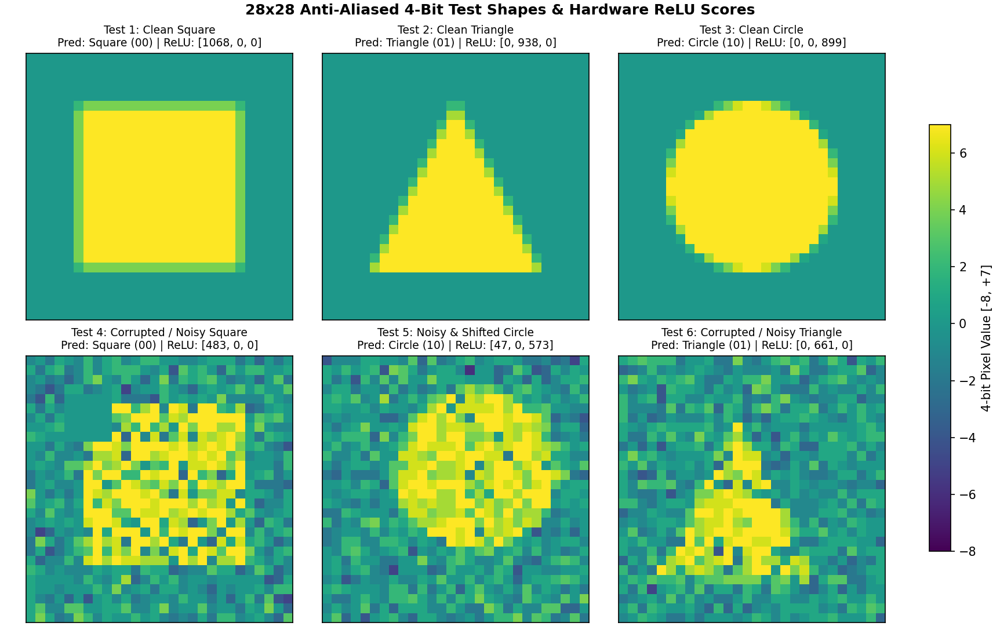

# 4-Bit Quantized Shape Classification Hardware Accelerator

## Overview
This project implements a **4-bit Quantized Neural Network Hardware Accelerator** in synthesizable Verilog-2001, capable of classifying **28×28 grayscale images (784 pixels, 4-bit signed per pixel)** into three geometric shapes without requiring an external CPU or operating system:

- `00` — **Square**
- `01` — **Triangle**
- `10` — **Circle**

The datapath uses 4-bit signed weights and activations (`[-8, +7]`), a saturation-protected 24-bit MAC accumulator, combinational bias addition, hardware ReLU activation, and a sequential Argmax comparator controlled by a Moore FSM. At a 50 MHz clock (20 ns period), a full 3-neuron inference completes in **94.22 µs** (`94220 ns`), with `predicted_class` valid immediately when `done` asserts.

## Repository Structure

### 1. `1_Chip_RTL`
Synthesizable Verilog-2001 hardware modules:
- `top_accelerator.v`: Top-level integration and combinational bias adder (`z = W·x + b`).
- `control_fsm.v`: Moore FSM controller (`S_IDLE -> S_FETCH -> S_MAC -> S_RELU -> S_OUTPUT -> S_DONE`).
- `mac_unit.v`: 4-bit signed Multiply-Accumulate unit with 24-bit saturation logic.
- `relu_unit.v`: MUX-based hardware ReLU unit.
- `argmax_unit.v`: Sequential hardware comparator driving `predicted_class` with zero-cycle lag on `done`.
- `memory_block.v`: Synchronous ROM/RAM block initialized via `$readmemh`.
- `agu.v`: Address Generation Unit for activations, weights, and neuron indices.

### 2. `2_Simulation`
Testbenches and quantized `.hex` memory files:
- `tb_brute_force.v`: System-level testbench running 6 shape scenarios (`test_1.hex`–`test_6.hex`) at 50 MHz and checking `predicted_class` against expected labels immediately on `@(posedge done)`.
- `tb_full_brute_force.v`: Exhaustive unit verification suite for `mac_unit` (all 256 signed 4-bit pairs + saturation) and `relu_unit` (270 total checks).
- `weights.hex`: `3 × 784 = 2352` quantized 4-bit weights.
- `biases.hex`: 3 quantized 24-bit two's complement biases.
- `acts.hex` and `test_1.hex`–`test_6.hex`: 784-pixel 4-bit test vectors (`Clean Square`, `Clean Triangle`, `Clean Circle`, `Corrupted / Noisy Square`, `Noisy & Shifted Circle`, `Corrupted / Noisy Triangle`).

### 3. `3_Model_Training_Python`
- `train_shape_model.py`: Generates 28×28 synthetic shape datasets using **8×8 supersampled anti-aliasing** (utilizing intermediate 4-bit grayscale edge levels `0..7`), trains a Softmax + Cross-Entropy linear classifier, quantizes weights/biases, verifies 6/6 scenarios against a bit-exact hardware Golden Model, writes all `.hex` files to `2_Simulation/`, and exports visualizations:
  - `weight_templates.png`: Learned 28×28 4-bit weight templates per neuron.
  - `test_shapes.png`: Anti-aliased 28×28 test inputs and hardware ReLU scores.




## How to Run

### 1. Train Model & Generate `.hex` Files (Python)
```bash
python 3_Model_Training_Python/train_shape_model.py
```

### 2. Run Hardware Simulation
Run inside `2_Simulation/` so `$readmemh` resolves the `.hex` files in the working directory:

**Questa / ModelSim:**
```bash
cd 2_Simulation
vlib work
vlog -work work ../1_Chip_RTL/*.v tb_brute_force.v tb_full_brute_force.v
vsim -c -lib work -do "run -all; quit -f" tb_full_brute_force
vsim -c -lib work -do "run -all; quit -f" tb_brute_force
```

**Icarus Verilog:**
```bash
cd 2_Simulation
iverilog -o sim.vvp ../1_Chip_RTL/*.v tb_brute_force.v
vvp sim.vvp
```
